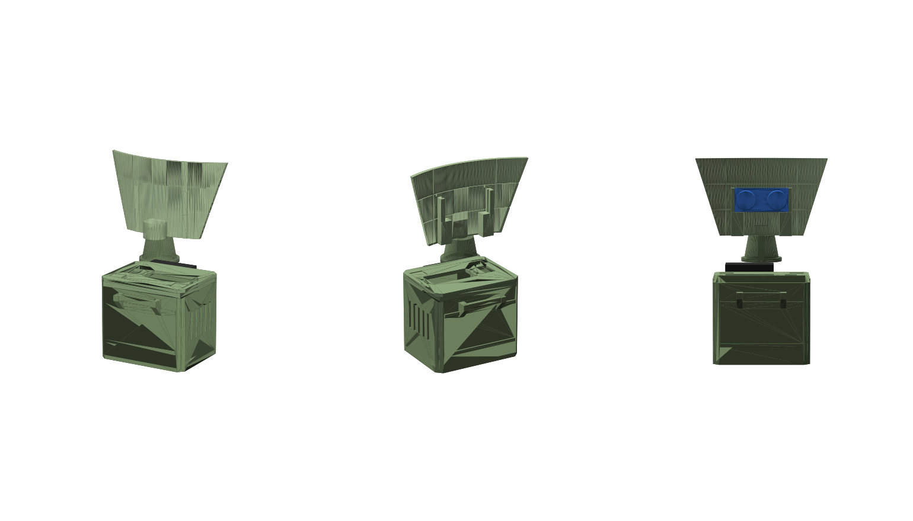

# 3D-prinditavad osad



Korpus on kaasaskantava sõjaväeradari stiilis: kast, mille peal on pöörlev mast ja kõver antenniketas.

| Fail | Osa | Mõõdud (mm) |
|---|---|---|
| `korpus.stl` | kast Arduino ja sensorkilbi jaoks | 81 × 83 × 68 |
| `kaas.stl` | kaas, mille avasse läheb servo | 81 × 65 × 9 |
| `mast.stl` | telg servo hoova peale | Ø34 × 30 |
| `antenn.stl` | antenniketas koos HC-SR04 hoidikuga | 110 × 35 × 65 |

## Printimine

- Prindi kõik osad samas asendis nagu STL-is. Tugesid pole vaja.
- Kaas on STL-is tagurpidi: pealispind on aluse vastas.
- Soovitus: PLA, kiht 0,2 mm, täide 15–20 %.

## Kokkupanek

1. Kinnita Arduino 4 isekeermestava M3 kruviga korpuse põhja tugedele. USB-C ja toitepesa jäävad seina avade kohale.
2. Lükka servo kaane avasse ülevalt alla, nii et kinnitusplaadid jäävad kaane peale. Kinnita servo enda kruvidega.
3. Pööra servo 90° asendisse, näiteks `servo.write(90)`. Pane ümmargune hoob võllile.
4. Liimi või kruvi mast hoova peale, nii et hoob jääb masti alumisse süvendisse. Masti keskel olev ava on kruvikeeraja jaoks.
5. Lükka HC-SR04 ülevalt antenni rööbastesse, nii et andurid vaatavad ette.
6. Pane antenn masti tapile. Tapi lame külg määrab antenni suuna. Kui antenn ei vaata servo 90° juures otse ette, keera hoob võllil ümber.
7. Vii anduri juhtmed läbi kaane ava kasti sisse. Jäta juhtmetele lõtku, et antenn saaks pöörata 15°–165°.

## Mõõtude muutmine

Osad tehakse failist `radar_model.py`. Kõik mõõdud ja lõtkud on faili alguses.

```bash
pip install manifold3d trimesh numpy
python radar_model.py
```

Kõige tõenäolisemalt tuleb muuta neid väärtusi:

- `TOL`: kui kaas või tapp on liiga tihe või liiga lõtv.
- `HORN_D`: sinu servo ümmarguse hoova läbimõõt.
- `USB_Y`, `JACK_Y`: kui avad ei ole pistikute kohal.
- `SERVO_BODY`, `SERVO_SHAFT`, `SERVO_HOLES`: kui servo ei mahu avasse.

Mõõdud on võetud andmelehtedelt, mitte mõõdetud päris osadelt. Enne suurt printi on mõistlik printida kaas ja kontrollida servo sobivust.
